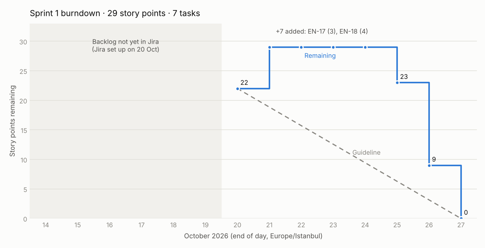

# Burndown Chart

Please present the burndown chart for each sprint.

## Sprint 1

## Sprint 2

**How to read the chart**

- The chart was taken on 14.11.2026 from the Jira board of Sprint 2 (28/10/2026 to 14/11/2026).
- Story points are kept on stories and tasks. Sub-tasks carry no story points.
- The scope grows from 37 to 46 story points (+9) because six items were added after the sprint had started. The instructor's feedback during the sprint changed the work plan (see the Sprint 2 retrospective). EN-27 and EN-28 are also the actions of the Sprint 1 retrospective.

| Item added | Story points | Created in Jira |
|---|---|---|
| EN-20 Prepare the article chunks from the six legal texts | 3 | 03/11/2026 |
| EN-21 Revise the Project Charter after the Sprint 1 feedback | 1 | 07/11/2026 |
| EN-22 Finalise the user stories | 1 | 07/11/2026 |
| EN-23 Write the story requirements with test cases | 2 | 07/11/2026 |
| EN-27 Hold the sprint walkthrough and write the deliverables checklist | 1 | 07/11/2026 |
| EN-28 Estimate every item in hours and check the sprint against capacity | 1 | 07/11/2026 |
| **Total** | **9** | |
## Sprint 3

## Sprint 4
