# System Architecture Design Document

| Team | Sprint | Status | Last updated | Updated by |
|---|---|---|---|---|
| Chunky | Sprint 1 | proposed | 2026-10-19 | [TEAM: name] |

## 1. Summary

Chunky answers a single-turn question in Turkish about road-traffic rules, procedures and penalties, and cites the articles (*madde*) of the legislation it used. The whole system runs on **one team laptop**; nothing leaves the machine and no external service is needed. An **offline indexing pipeline** turns six legal texts from mevzuat.gov.tr into article-level chunks, embeds them with a local embedding model and stores the vectors in a vector database. When a user asks a question, the **retriever** embeds the question with the same model, finds the most similar chunks in the vector database, a **reranker** orders the candidates and keeps the best ones, and a local open-weight **LLM** writes the answer from those chunks only, citing the articles. The embedding model and the LLM are served by **Ollama** on the laptop; the reranker runs inside the Python application. The user reaches the system through a chat page (Gradio or Streamlit). Scope, users and stakeholders are in the [Project Executive Summary](03-project-canvas/01-project-executive-summary.md).

## 2. Goals and non-goals

### Goals

- Answer questions from the six-text corpus with article citations, so that every claim can be checked against the law — charter objective 1 ([Executive Summary](03-project-canvas/01-project-executive-summary.md)).
- Say "the answer is not in these texts" instead of guessing when the corpus does not cover the question — charter objective 2.
- Measure retrieval and answer quality every sprint against a baseline, with numbers rather than adjectives — [Deliverables](03-project-canvas/05-deliverables.md).
- Run entirely on team hardware, with no external dependency: the final demo must work on the host laptop with the network disconnected.

### Non-goals

- Multi-turn dialogue; each question is answered on its own.
- A separately maintained table of current fine amounts; the system quotes the amounts in the texts and reminds the user that they are revalued each year.
- Personalised legal advice, or any use beyond the six texts in `data/manifest.csv`.
- Training or fine-tuning a model; all models are used as served.

## 3. System architecture diagram

**Version:** v1 (2026-10-19)

Editable source: `docs/images/architecture-v1-local.svg`. The same diagram as Mermaid, for GitHub rendering and diffs:

```mermaid
flowchart LR
    subgraph laptop ["Team laptop · Windows · Core Ultra 7 255H · 16 GB RAM · CPU inference"]
        subgraph ollama ["Ollama · local model server (OpenAI-compatible API)"]
            embed["Embedding model<br/>Qwen3-Embedding 0.6B"]
            llm["LLM<br/>Qwen3 4B"]
        end

        subgraph offline ["Offline · indexing (runs once per corpus version)"]
            source[("Source texts<br/>6 legal texts")] -->|"PDF"| extract["Text extraction<br/>& cleaning · Python"]
            extract -->|"clean text"| chunker["Chunker<br/>article-level"]
            chunker -->|"chunks + metadata"| indexer["Indexer<br/>Python"]
            indexer -->|"vectors + metadata"| vdb[("Vector database<br/>(Chroma / FAISS / Qdrant)")]
        end

        subgraph online ["Online · question answering"]
            user(["AI user<br/>driver / learner driver"]) -->|"question"| ui["Chat UI<br/>Gradio / Streamlit"]
            ui -->|"question"| retriever["Retriever<br/>Python"]
            rerank["Reranker<br/>Qwen3-Reranker 0.6B"]
            retriever -->|"similarity search"| vdb
            vdb -->|"candidate chunks"| rerank
            rerank -->|"top chunks"| llm
            llm -->|"answer with article citations"| ui
        end
    end

    indexer -.->|"embeds chunks"| embed
    retriever -.->|"embeds question"| embed
```

Solid arrows are data flow; dotted arrows show that the indexer and the retriever both call the same embedding model, so chunks and questions are embedded in the same vector space. Box outline colour: green = data store, amber = model, navy = component (own code or library). Confluence does not render Mermaid; attach the PNG to the Confluence page by hand after each sync.

## 4. Components

| Component | Responsibility | Technology and version | SBOM entry |
|---|---|---|---|
| AI user | Asks one question at a time in Turkish; reads the answer and its cited articles | Browser on the host laptop or on the same local network | — |
| Source texts | The six legal texts: Kanun 2918 and five regulations; URL, licence, version date | PDF from mevzuat.gov.tr | — (datasheet, not software) |
| Text extraction & cleaning | PDF → plain text; removes page headers, footnotes and repeated headings so that article boundaries are clean | Python [TEAM: version], PDF-to-text library [TEAM: pdftotext / pypdf / pdfplumber, version] | per chosen library |
| Chunker | Splits the text at article (*madde*) boundaries; attaches document, section and article metadata to every chunk | Python, own code | — |
| Indexer | Sends every chunk to the embedding model and writes the vectors with their metadata into the vector database; re-run when a text or the chunking changes | Python, own code | — |
| Embedding model | Turns chunk texts and questions into vectors in the same space | To be chosen: Qwen3-Embedding 0.6B, served by Ollama | AI SBOM: Qwen3-Embedding-0.6B |
| Vector database | Stores chunk vectors and metadata; returns the chunks most similar to a question vector | To be chosen: Chroma, FAISS or Qdrant (D3) | per chosen store |
| Retriever | Embeds the question, queries the vector database, hands the candidate chunks to the reranker and the selected chunks with the system prompt to the LLM; returns the answer and the source chunks to the UI | Python, own code; OpenAI-compatible client for Ollama | openai (Python SDK) |
| Reranker | Scores each candidate chunk against the question and keeps the best ones; runs on the CPU inside the Python application, because Ollama does not serve rerankers | To be chosen: Qwen3-Reranker 0.6B via `transformers` [TEAM: version] + `torch` (CPU) | AI SBOM: Qwen3-Reranker-0.6B; transformers, torch |
| LLM | Writes the answer from the selected chunks only, with article citations; refuses when the chunks do not contain the answer; also used as the judge model for the RAG-triad evaluation | To be chosen: Qwen3 4B (4-bit quantisation), served by Ollama | AI SBOM: Qwen3-4B |
| Ollama | Local model server: downloads and serves the embedding model and the LLM, exposes an OpenAI-compatible HTTP API on the laptop | Ollama [TEAM: version], Windows installer | ollama |
| Chat UI | Question box, streamed answer, the cited chunks shown under the answer | Gradio or Streamlit (D7) [TEAM: version] | gradio / streamlit |

## 5. Design details

### Data pipeline

- **Sources.** Six consolidated texts from mevzuat.gov.tr (public legislation; terms of use checked). Each file is recorded in `data/manifest.csv` with URL, retrieval date, version date and checksum, so a changed text is detected and triggers a rebuild of the chunks and the index.
- **Cleaning.** Page headers, footnote markers and amendment notes are removed so that they do not get glued to article text.
- **Chunking.** One chunk per article (*madde*); very long articles may be split by paragraph (*fıkra*). The article is the legal citation unit, so the chunk's article id is also what the answer cites and what the evaluation set labels.
- **Storage.** Chunks and the vector database are kept on the host laptop and the chunk file is committed to the repository (text only); the PDFs are not committed, only their checksums. No personal data is processed.
- **No labelling, no train/validation/test split of the corpus** — no model is trained. The evaluation question set is kept apart from the questions used while tuning the prompt (see Evaluation).

### Model

- **Selection, not training.** All three models are open-weight, downloaded once from the Ollama library and the Hugging Face Hub, and used as served.
- **Why these sizes.** The host has no CUDA GPU; inference runs on a 16-core CPU with 16 GB of RAM shared with everything else. A 4B-parameter LLM in 4-bit quantisation is the largest answer model that leaves room for the embedding model, the reranker and the UI and still streams tokens at a readable rate on the CPU. The 0.6B embedding and reranker models are the smallest members of the same Qwen3 model families; all three families support Turkish.
- **Embedding.** Qwen3-Embedding 0.6B through Ollama. The same model embeds the chunks (offline) and the question (online); if the embedding model changes, the index is rebuilt.
- **Reranking.** Qwen3-Reranker 0.6B scores (question, chunk) pairs; implemented with `transformers` on the CPU inside the retriever, loaded once at start-up.
- **LLM.** Qwen3 4B. Qwen3 can switch its "thinking" step on or off per request; which mode the system uses is decided by experiment (D8). The context window is set large enough for the system prompt, the selected chunks and the question.
- **Prompting.** One system prompt, versioned in `prompts/`: answer only from the given chunks; if they do not contain the answer say *"Elimdeki mevzuat metinlerinde bu sorunun cevabı yok."*; cite the article for every claim; quote fine amounts as written and note that they are revalued yearly; answer in short, plain Turkish. The prompt variant is a parameter in `config/rag.yaml`.
- **Judge model.** The RAG-triad metrics are computed with an open Python evaluation library (RAGAS or DeepEval) using the same local LLM as judge. A judge that is also the model under test tends to agree with itself; this is recorded as a risk and bounded by a manual spot-check of the scores every sprint.

### Evaluation

- **Retrieval metrics.** Precision@k, Recall@k and MRR against gold articles (the course's recommended retrieval metrics); reported with and without the reranker so its contribution is visible.
- **Answer metrics.** The RAG triad — context relevance, groundedness, answer relevance — computed with RAGAS or DeepEval and the local judge; plus two rule-based rates that need no judge: citation rate (answers that cite at least one retrieved article) and refusal correctness (out-of-corpus questions answered with the refusal sentence, in-corpus questions not refused). Manual verification of the evaluation answers is the ground truth in Sprint 1.
- **Baseline.**
- **Latency.** Retrieval time, time to first token and full-answer time per question, measured on the host CPU. Targets are set after the first measurement and then written into the charter.
- **Validation vs. test.** The question set used while tuning the prompt and the retrieval settings is the *validation* set. A second set, written by team members who did not tune the prompt, is the *test* set and is run only at sprint ends.

### Interfaces

| From | To | What passes | Format or protocol |
|---|---|---|---|
| Source texts | Text extraction & cleaning | PDF file | local file |
| Text extraction & cleaning | Chunker | clean plain text | UTF-8 text |
| Chunker | Indexer | chunks with article metadata | JSON Lines |
| Indexer | Embedding model | chunk texts | HTTP, Ollama `/v1/embeddings` (OpenAI schema) on localhost |
| Indexer | Vector database | vectors + metadata | the store's Python client / local files |
| AI user | Chat UI | question in Turkish | browser, HTTP |
| Chat UI | Retriever | question | Python call |
| Retriever | Embedding model | question text | HTTP, Ollama `/v1/embeddings` on localhost |
| Retriever | Vector database | question vector; returns candidate chunks with similarity scores | the store's Python client, in process |
| Vector database | Reranker | candidate chunks | Python objects, in process |
| Reranker | LLM | top chunks, assembled by the retriever into system prompt + chunks + question | HTTP, Ollama `/v1/chat/completions` on localhost, streamed |
| LLM | Chat UI | answer with article citations, token by token; the retriever passes the cited chunks along | server-sent event stream → Python generator |

### Deployment

| Stage | Where it runs | How users reach it |
|---|---|---|
| Development and internal testing (Sprint 1–2) | Everything on the host laptop (Core Ultra 7 255H, 16 GB RAM, Windows, Python virtual environment, Ollama service); CPU inference. Other team laptops can run the application against the host's Ollama over the local network, or run their own Ollama with the same models | Each member starts the chat page locally |
| MVP (Sprint 3) | Host laptop | Local-network URL shown by the UI; no cloud deployment, nothing leaves the laptop |
| Final demo (30 Dec 2026) | Host laptop, offline-capable | Projected from the host laptop |

Resources (laptop, Ollama, model downloads) are listed in [Facilities & Resources](03-project-canvas/09-facilities-and-resources.md).

## 6. Decisions

### D1: Where the models run — on a team laptop

**Context:** The team decided on 11 Oct 2026 to use open-weight models rather than a hosted proprietary API. Three places to run them were considered. The budget line names $100 of Google Cloud credits whose usability is unconfirmed; one team member has an account on EVREN, the national AI platform, whose API serves open-weight models; and the team owns three usable Windows laptops (a fourth, a MacBook, is excluded by team decision).

**Options considered:**

| Option | Pros | Cons |
|---|---|---|
| Google Cloud GPU VM paid from the credits | Room for larger models | Usability of the credits unconfirmed; VM must be started and stopped by hand; credit can run out before the demo |
| EVREN API (national platform) | Large open-weight models without local hardware | External dependency; free period and credit rules outside the team's control; not yet evaluated by the team |
| **Team laptop** | No external dependency, no cost, works offline; simplest to set up and to demo | Model size bounded by laptop memory; CPU inference is slow |
| Hosted proprietary API (e.g. Gemini) | Best quality | Not open-weight; weakens the project's RAG justification; rejected 16 Oct 2026 |

**Decision:** Team laptop, specifically the Core Ultra 7 laptop (D2). The other two options stay in the decision log as alternatives if the laptop variant proves insufficient.

**Why:** It is the only option fully under the team's control, and it is enough for a demonstrable MVP on this corpus.

**Consequences:** Model sizes are bounded by 16 GB RAM (D4, D5); latency is a CPU figure; the design must be tested with the network disconnected.

**Evidence:** Hardware list collected on 16 Oct 2026.

**Owner and date:** [TEAM: name], 2026-10-19

**Status:** proposed

### D2: Host — one machine, the Core Ultra 7 laptop

**Context:** Of the three laptops, one has a CUDA GPU with 4 GB VRAM and 16 GB RAM; one has 32 GB RAM but a low-power CPU and no GPU; one has the strongest CPU (Core Ultra 7 255H, 16 cores), 16 GB RAM and an Intel Arc integrated GPU.

**Options considered:**

| Option | Pros | Cons |
|---|---|---|
| Split across two laptops (GPU laptop serves the LLM, 32 GB laptop runs indexing and evaluation) | Uses the only CUDA GPU | Two machines to keep configured; the demo depends on both |
| One machine: the RTX 3050 laptop | Best-supported acceleration path | 4 GB VRAM limits the LLM to the same 4B class anyway; weakest CPU for the reranker |
| One machine: the 32 GB laptop | Largest RAM | Slowest CPU; interactive answers would be slow |
| **One machine: the Core Ultra 7 laptop** | Strongest CPU for CPU inference and the reranker; 16 GB is enough for the chosen models; owner has prior chatbot-project experience; Arc iGPU available as an upside experiment | No CUDA; Arc acceleration in Ollama is experimental, so the baseline is CPU-only |

**Decision:** One machine, the Core Ultra 7 laptop, CPU baseline.

**Why:** Simplest deployment, best CPU for a CPU-bound design, and the owner's experience with the stack.

**Consequences:** The RTX 3050 laptop remains a possible second host for the same 4B model on its GPU; to be tried as a speed comparison.

**Evidence:** Hardware list, 16 Oct 2026; measurements from the laptop spike (section 7).

**Owner and date:** [TEAM: name], 2026-10-19

**Status:** proposed

### D3: Vector database — to be chosen among Chroma, FAISS and Qdrant

**Context:** The corpus is a few hundred to a few thousand article-level chunks; the store must run locally without a server process the team has to manage, and its Python client must be easy for the whole team.

**Options considered:**

| Option | Pros | Cons |
|---|---|---|
| Chroma | Embedded (no server), persistent, metadata filters, LangChain integration, used in the course example | One more dependency; slower than FAISS at scale (irrelevant here) |
| FAISS | Fastest search; a library, not a database | No metadata or persistence of its own; Windows install friction |
| Qdrant | Full-featured, metadata filters, local mode available | Heavier than needed for this corpus |

**Decision:** Open; a short spike compares Chroma and FAISS on the actual corpus (install on Windows, persistence, metadata filtering by document and article). Qdrant is the fallback if both disappoint.

**Why:** All three work at this scale; the decisive factors are installation on the team's Windows laptops and metadata support for citations, which are best judged by trying.

**Consequences:** The indexer and retriever talk to the store through a thin wrapper so the choice can change without touching the rest.

**Evidence:** Vector-store spike, Sprint 2.

**Owner and date:** [TEAM: name], 2026-10-19

**Status:** proposed

### D4: Embedding model and reranker — Qwen3 0.6B family, local

**Context:** Both models must run on the CPU in seconds and support Turkish.

**Options considered:**

| Option | Pros | Cons |
|---|---|---|
| **Qwen3-Embedding 0.6B (Ollama) + Qwen3-Reranker 0.6B (transformers)** | Same model family as the LLM; small (about 0.6 GB and 1.2 GB); multilingual incl. Turkish; both run on CPU in seconds | Ollama has no rerank endpoint, so the reranker needs `transformers` + `torch` (about 2 GB of extra dependencies) |
| Qwen3-Embedding 4B | Better retrieval | Embedding the corpus and each question on CPU is much slower; more RAM |
| bge-m3 + bge-reranker-v2-m3 | Well-known multilingual pair | Different family from the LLM; no advantage shown for Turkish legal text |
| No reranker | One component fewer | Retrieval precision depends entirely on a 0.6B embedder |

**Decision:** Qwen3-Embedding 0.6B on Ollama; Qwen3-Reranker 0.6B via `transformers` on the CPU inside the retriever; the pipeline can run with the reranker switched off for comparison.

**Why:** One model family throughout, sizes the host can run, and a measurable reranker contribution.

**Consequences:** `transformers` and the CPU build of `torch` enter the SBOM; the reranker is loaded once at start-up.

**Evidence:** Retrieval metrics with and without the reranker (Sprint 2).

**Owner and date:** [TEAM: name], 2026-10-19

**Status:** proposed

### D5: LLM — Qwen3 4B on Ollama

**Context:** The model must fit next to the embedding model and reranker in 16 GB of RAM, run on CPU at a readable token rate, handle Turkish and follow citation and refusal instructions.

**Options considered:**

| Option | Pros | Cons |
|---|---|---|
| **Qwen3 4B (4-bit)** | About 2.5 GB; fits with room to spare, and also fits the 4 GB VRAM of the RTX 3050 laptop whole; Turkish support; thinking switchable per request; same family as the embedding and reranker models | Small model: weaker instruction following than larger models; to be quantified |
| Gemma 4 E2B (about 2.9 GB) | Fits | Smallest member of its family; larger quality drop expected |
| Gemma 4 E4B (about 4.5 GB) | Better quality than E2B | Does not fit the RTX 3050's VRAM whole; kept as a comparison candidate |
| Qwen3 8B (about 5 GB) | Noticeably stronger | Roughly half the CPU token rate; kept as a comparison candidate if 4B is insufficient |

**Decision:** Qwen3 4B as the default; Gemma 4 E4B and Qwen3 8B as comparison candidates in the model experiment.

**Why:** Best fit for the memory and speed constraints with Turkish support; the only candidate that also runs whole on the team's single CUDA GPU.

**Consequences:** Citation rate and refusal correctness are explicit metrics, because a small model follows the system prompt less reliably.

**Evidence:** Model experiment on the evaluation set (Sprint 2).

**Owner and date:** [TEAM: name], 2026-10-19

**Status:** proposed

### D6: Runtime — Ollama, CPU baseline, Arc iGPU as an experiment

**Context:** Something has to load the models and expose them to the Python code. The host has an Intel Arc 140T iGPU whose support in local-inference tools is improving but not settled.

**Options considered:**

| Option | Pros | Cons |
|---|---|---|
| **Ollama** | OpenAI-compatible local API; model download, quantisation and memory management handled; one service for embedding and chat; Windows installer | No rerank endpoint; Arc acceleration experimental |
| LM Studio | GUI; Vulkan backend for Intel Arc | Harder to script and reproduce; designed for one interactive user |
| llama.cpp (`llama-server`) | Fastest and most tunable; direct Arc builds | Manual model management; harder for the whole team to install identically |

**Decision:** Ollama; CPU inference is the documented baseline. Arc acceleration is a time-boxed experiment; if it gives a measured speed-up with identical outputs, D6 is revised.

**Why:** Reproducible on any team laptop; promises nothing that has not been measured.

**Consequences:** Latency targets are CPU targets; model tags and the Ollama address are recorded in `config/rag.yaml` and the README.

**Evidence:** Tokens per second, CPU vs. Arc, same prompts (Sprint 2).

**Owner and date:** [TEAM: name], 2026-10-19

**Status:** proposed

### D7: Chat UI — Gradio or Streamlit

**Context:** A demo page is needed from Sprint 2; the team has no front-end developer profile, so the UI must be pure Python.

**Options considered:**

| Option | Pros | Cons |
|---|---|---|
| Gradio | Chat component with streaming built in; very little code; easy temporary sharing link | Fewer layout options for showing the source chunks |
| Streamlit | Flexible layout for answer + source-chunk panel; chat widgets and streaming | Slightly more code; sharing needs a tunnel or Community Cloud |
| Command line only | Nothing to build | Not usable by the end users in the charter |

**Decision:** Open between Gradio and Streamlit; decided when the first UI is built (Sprint 2), by whichever shows the answer and the cited chunks side by side with the least code.

**Why:** Both are adequate; the difference is small and best judged on the actual page.

**Consequences:** The UI only calls the retriever; the choice does not affect the rest of the system.

**Evidence:** First UI prototype, Sprint 2.

**Owner and date:** [TEAM: name], 2026-10-19

**Status:** proposed

### D8: LLM thinking mode — decided by experiment

**Context:** Qwen3 can run a "thinking" step before answering. It may improve citation and refusal behaviour on a small model, but on a CPU it can multiply the answer time.

**Options considered:**

| Option | Pros | Cons |
|---|---|---|
| Off | Fastest | Possible accuracy loss on a small model |
| On | May improve accuracy | Answers may take minutes on CPU |
| **Both measured, winner becomes the default** | Decision backed by numbers on this hardware | The experiment takes twice as long |

**Decision:** Both modes are run on the evaluation set (accuracy, citation rate, refusal correctness, full-answer time); the better trade-off becomes the default in `config/rag.yaml`. The judge model runs with thinking on in either case.

**Why:** No measurement exists for this model on this hardware.

**Consequences:** Thinking on/off stays a configuration parameter.

**Evidence:** Thinking-mode experiment card, Sprint 2.

**Owner and date:** [TEAM: name], 2026-10-19

**Status:** proposed

### D9: Evaluation — open Python libraries with the local LLM as judge

**Context:** The course asks for retrieval metrics and RAG-performance metrics (RAG triad) against a baseline. In this variant there is no larger model available to act as judge.

**Options considered:**

| Option | Pros | Cons |
|---|---|---|
| **RAGAS or DeepEval, judge = the same Qwen3 4B** | Automated triad with open libraries; no extra model or memory | Judge = model under test (self-agreement bias); small judge is noisy |
| A larger local judge run as a batch | Stronger judge | More RAM; only possible when the answer model is unloaded; longer runs |
| Manual scoring only | Exact | Does not scale past a few dozen questions |

**Decision:** RAGAS or DeepEval (library chosen when first set up) with the local Qwen3 4B as judge; plus citation rate and refusal correctness, which need no judge; plus a manual spot-check of the triad scores every sprint. Retrieval metrics remain the primary evidence.

**Why:** Keeps the evaluation fully local and automated while naming the bias and bounding it.

**Consequences:** The evaluation runner is a separate script that calls the same retriever and LLM; its results are logged per sprint.

**Evidence:** First evaluation run, Sprint 2.

**Owner and date:** [TEAM: name], 2026-10-19

**Status:** proposed

## 7. Open design areas

| Area | What is open | Settled by |
|---|---|---|
| Vector database (D3) | Chroma vs. FAISS (Qdrant as fallback): Windows installation, persistence, metadata filtering | Vector-store spike, Sprint 2 |
| Chat UI (D7) | Gradio vs. Streamlit | First UI prototype, Sprint 2 |
| Laptop spike | Whether the chosen models run together on the host within 16 GB and at an acceptable answer time; retrieval quality of the 0.6B embedder on this corpus | Laptop spike, Sprint 2 |
| Arc iGPU (D6) | Whether Ollama runs the LLM faster on the Arc 140T than on the CPU, with identical outputs | Time-boxed experiment inside the laptop spike |
| Thinking mode (D8) | On or off as the default | Thinking-mode experiment, Sprint 2 |
| LLM fallback (D5) | Whether Qwen3 8B or Gemma 4 E4B replaces Qwen3 4B if its accuracy is below the threshold the team sets | Model experiment, Sprint 2 |
| Evaluation library (D9) | RAGAS vs. DeepEval with an Ollama-served judge | First evaluation run, Sprint 2 |
| Latency targets | Replace the charter's "under 2 seconds" with measured retrieval / first-token / full-answer targets | Charter revision after the laptop spike |

## 8. Change log

| Version | Date | Change | Pull request |
|---|---|---|---|
| v1 | 2026-10-19 | First version: single-laptop architecture, Qwen3 model family on Ollama, decisions D1–D9 | [TEAM: PR] |

## Checklist before submitting

- [x] Every box in the diagram has a row in Components, and every row has a box.
- [x] Every arrow in the diagram has a row in Interfaces.
- [ ] Every technology in Components appears in the SBOM under the same name and version — versions to be pinned once installed ([TEAM]).
- [x] Every technology in Components has a decision in section 6.
- [x] Every relevant spike has a decision in section 6, or a note in Open design areas saying why not.
- [x] The diagram version matches the latest change log entry.

## References

[1] GitLab Inc. "Design document template" (`_template.md`). The GitLab Handbook. https://gitlab.com/gitlab-com/content-sites/handbook/-/blob/main/content/handbook/engineering/architecture/design-documents/_template.md

[2] GitLab Inc. "Architecture Design Workflow." The GitLab Handbook. https://handbook.gitlab.com/handbook/engineering/architecture/workflow/

[3] Ollama model library. https://ollama.com/library

[4] Qwen team, *Qwen3-Embedding* and *Qwen3-Reranker* model cards. https://huggingface.co/Qwen
