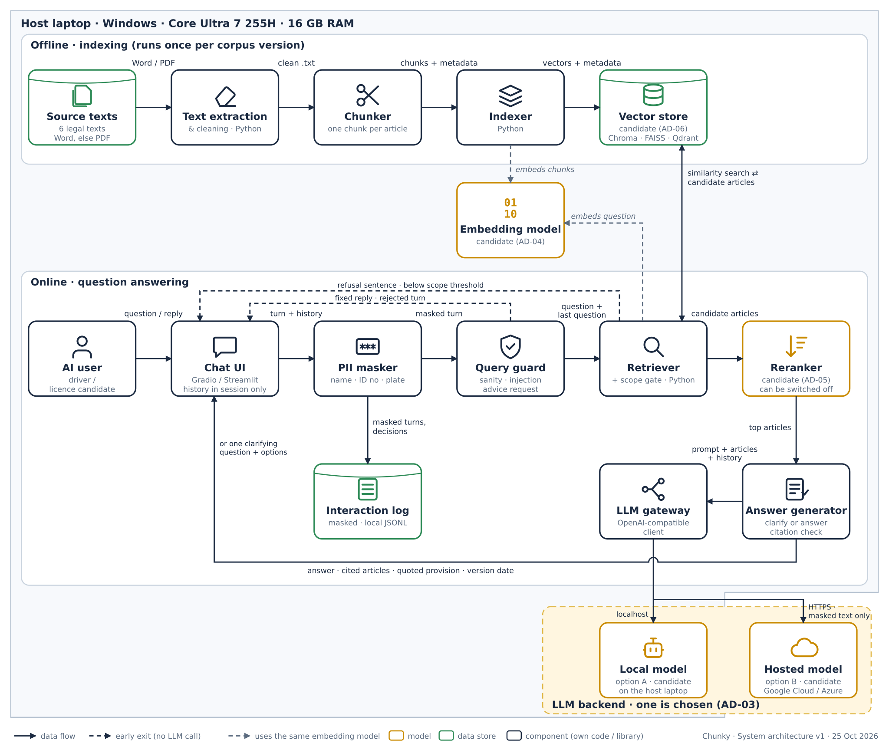
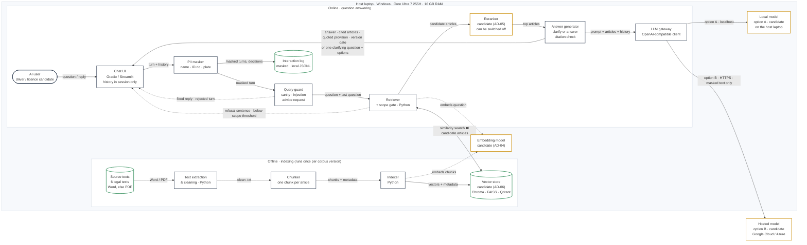
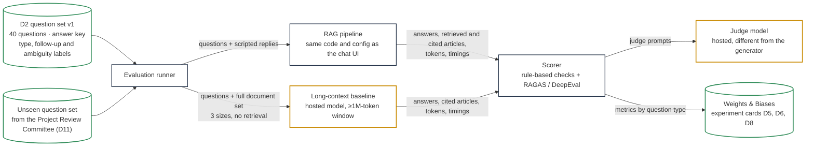

# System Architecture Design Document

| Team | Sprint | Status | Last updated | Updated by |
|---|---|---|---|---|
| Chunky | Sprint 1 | draft | 2026-10-25 | Özge Çalışkan |

## 1. Summary

Chunky answers questions in Turkish about road-traffic rules and penalties. Each answer names the article of the legislation it rests on and shows the quoted provision. The document set is six legal texts taken from mevzuat.gov.tr ([Project Executive Summary](03-project-canvas/01-project-executive-summary.md), Scope Definition; C-01). Their sources, versions and location in the repository are recorded in the Third-party Dataset Register.

The RAG pipeline runs on **one team laptop**, and users reach the chat page on that laptop. Nothing is deployed to the cloud. The only part of the system that may leave the laptop is the **language model call**. Whether the LLM runs locally or is reached through a hosted API on Google Cloud or Azure is still open (AD-03). For that reason the pipeline talks to the LLM through a provider-agnostic **LLM gateway**, so the backend is a configuration choice, not a code change. The embedding model, reranker and vector store are also not yet chosen; this document names the candidates and the experiment that decides each one.

There are two flows. An **offline indexing flow** turns the six texts into one chunk per article, embeds them and stores them in a vector store. An **online question-answering flow** handles each user turn as follows:

1. Personal data is masked first.
2. A **query guard** rejects unsafe input, prompt-injection attempts and requests for advice on an individual case.
3. For a follow-up question, the user's previous question in the session is joined to the new one, so that retrieval sees the topic.
4. The retriever and reranker find the relevant articles. A **scope gate** declines the question if no article is relevant enough.
5. The LLM receives the articles and the session history, and either asks **one clarifying question** (when a missing condition changes the answer) or writes the answer from the retrieved articles only.

Quality is measured automatically on the question set D2 against two baselines: the time users need without the assistant (D3) and a long-context model that reads the whole document set with no retrieval (D5).

## 2. Goals and non-goals

### Goals

Each goal names the objective in the [Project Executive Summary](03-project-canvas/01-project-executive-summary.md) or the constraint in [Assumptions & Constraints](03-project-canvas/03-assumptions-and-constraints.md) that it serves.

- **Correct, cited answers (Objective 2; Features 1–3).** Answers come only from retrieved articles. Each answer names the text and article number, and the UI shows the quoted provision taken from the stored text, not generated by the model.
- **Decline what the document set does not cover (Objective 4; Feature 4; C-01, C-11).** Questions outside the six texts and requests for advice on an individual case receive a fixed reply. The model does not attempt an answer.
- **Fast enough for the pilot (Objective 1).** End-to-end answer time must leave room for a participant to reach a correct answer in under 2 minutes (median). Retrieval time, time to first token and full-answer time are measured on the host laptop.
- **Clear answers (Objective 3).** Answers are short, in plain Turkish, with the source shown under them.
- **Follow-up and ambiguous questions (C-05).** Follow-up questions within a session are understood. When one missing condition changes the answer, the assistant asks one clarifying question.
- **No personal data stored (C-12).** Names, national ID numbers and licence plates are masked before anything is logged or sent to a model.
- **Measured against two baselines in every sprint** ([Deliverables](03-project-canvas/05-deliverables.md) D3, D5, D6, D8). Results are reported by question type and tracked in Weights & Biases.

### Non-goals

- Cloud deployment or public release, including the official EGM web page (Major Activities row 26). The system runs on the host laptop.
- Updating the document set or the answer key after an amendment (C-02). The texts are a snapshot with a recorded version date.
- Current (revalued) fine amounts. Fines are given as written in the texts, and the chat page carries a fixed notice about this (section 5, Answer format).
- Advice on an individual case, or personal penalty, licence and vehicle record queries (C-07, C-11).
- Clarification dialogues of more than one turn (Major Activities row 29).
- Saved conversation history, user accounts or authentication (C-12). History lives only in the browser session.
- Training or fine-tuning a model (C-04, C-08). All models are used as served.
- Languages other than Turkish (C-03).

## 3. System architecture diagram

**Version:** v1 (2026-10-25)

Editable source: `docs/images/architecture-v1-local.svg`. The Mermaid diagram in 3.1 shows the same design as the PNG, for GitHub rendering and diffs; the evaluation flow in 3.2 exists only as Mermaid. Confluence does not render Mermaid; attach the PNG to the Confluence page by hand after each sync.

### 3.1 Runtime: indexing and question answering

Solid arrows are data flow. Dotted arrows from the indexer and the retriever show that both use the same embedding model, so chunks and questions share one vector space. Dotted arrows into the chat UI are early exits: the guard and the scope gate reply without calling the LLM. Options A and B are the two candidate LLM backends of AD-03; only one is used in a given configuration. The hosted model is the only component outside the laptop. If the embedding model or reranker chosen in AD-04 or AD-05 is a hosted service, it is called in the same way and receives only masked text. Box outline colour: green = data store, amber = model, navy = component (own code or library).

### 3.2 Evaluation

The default-state baseline (D3) is a timed test with people and no system, so it has no box here. Its result is the reference for Objective 1 in the pilot report (D10).

## 4. Components

"Candidate" marks a technology that is not yet chosen; the decision that chooses it is named in brackets.

| Component | Responsibility | Technology and version | SBOM entry |
|---|---|---|---|
| AI user | Asks questions in Turkish, answers a clarifying question by tapping an option, reads the answer and its cited articles | Browser on the host laptop | — |
| Source texts | The six texts of the document set (C-01). Source files in `data/legal/pdf/`, numbered `01_kanun_2918` … `06_elektrikli_skuter`; the Word version is used where mevzuat.gov.tr offers it, otherwise the PDF (AD-09). Source URL, date of access and version (consolidated text date) of each text are recorded in the Third-party Dataset Register | Files from mevzuat.gov.tr | — (Third-party Dataset Register; Dataset Report D1) |
| Text extraction & cleaning | Turns each source file into clean UTF-8 text: removes footnotes, Official Gazette tables, page headers and footers so that article boundaries are clean. Writes one plain-text file per text to `data/legal/`, with the same numbering (D1, acceptance criterion 2) | Python [version]; `pdftotext -layout` (poppler) [version] for PDF; `python-docx` [version] for Word | poppler-utils; python-docx |
| Chunker | Splits each text at article boundaries: one chunk per article. An article longer than the embedding model's input limit gets retrieval-only sub-chunks that point to the same article ID (AD-08). Attaches metadata to every chunk: text number and name, article number and heading, section, and the source URL, date of access and version date from the Third-party Dataset Register | Python, own code | — |
| Indexer | Embeds every chunk and writes vectors and metadata into the vector store. Re-run when a text, the chunking or the embedding model changes | Python, own code | — |
| Embedding model | Turns chunks and questions into vectors in the same space | Candidate (AD-04) | AI SBOM: chosen model |
| Vector store | Stores chunk vectors and metadata; returns the chunks most similar to a question vector, with metadata filters by text and article | Candidate: Chroma / FAISS / Qdrant (AD-06) | per chosen store |
| Chat UI | Question box; streamed answer; cited articles with quoted provision and version date under the answer; clarifying-question options as buttons; a fixed notice on fine amounts; session history held in the browser session only, cleared when the session ends | Candidate: Gradio / Streamlit (AD-14) [version] | gradio / streamlit |
| PII masker | Masks personal data in every user turn before anything is logged, checked or sent to a model: national ID numbers (11 digits with the official check-digit rule), licence plates (province code, letters, digits) and personal names (Major Activities row 10; C-12) | Python, own code: regular expressions and check-digit rule; name detection by a candidate Turkish NER model or a name list (AD-10) | NER model if adopted |
| Query guard | Rule-based checks on the masked turn, in order: sanity (empty, too long, not Turkish), prompt injection, request for advice on an individual case. A rejected turn gets a fixed reply and never reaches retrieval or the LLM; the decision is logged | Python, own code; LLM-based intent classifier as an experiment (AD-10) | — |
| Retriever and scope gate | Builds the retrieval query (the current question; for a follow-up, joined with the user's previous question in the session, AD-11), embeds it, queries the vector store and returns the top-k candidate articles. The scope gate declines the question with the refusal sentence if the best reranker score (or the best similarity when the reranker is off) is below a threshold set on D2 | Python, own code | — |
| Reranker | Scores each (question, article) pair and keeps the best ones; can be switched off for comparison | Candidate (AD-05) | AI SBOM: chosen model |
| Answer generator | One structured LLM call per turn that receives the question, the top articles and the masked session history, and returns either a clarifying question with its options or an answer with the IDs of the articles it rests on (AD-11). A rule-based citation check removes any cited ID that was not among the retrieved articles. The quoted provision and version date shown to the user are taken from the vector store by article ID, not generated | Python, own code; prompts versioned in `prompts/`; parameters in `config/rag.yaml` | — |
| LLM gateway | Single client through which every LLM call passes. Reads backend, model name, model version and generation settings from `config/rag.yaml`; records input and output tokens per call for cost reporting. API keys are read from a local `.env` file that is not committed | OpenAI-compatible Python client (AD-03) | openai (Python SDK) or provider SDK |
| LLM backend | Generates clarifying questions and answers | Candidate: option A, a local model on the host laptop through a local runtime (AD-07); option B, a hosted model on Google Cloud (Vertex AI) or Azure (Azure OpenAI / Azure AI Foundry) (AD-03) | AI SBOM: chosen model and version |
| Interaction log | Keeps masked turns, guard and scope decisions, retrieved article IDs, answers and timings, so that false rejections and wrong answers can be reviewed | Local JSON Lines file on the host laptop | — |
| Evaluation runner | Runs D2 (and later the unseen set for D11) through the RAG pipeline and through the long-context baseline; feeds scripted replies to clarifying questions; records answers, articles, tokens and timings | Python, own code | — |
| Long-context baseline | Answers D2 from the full document set with no retrieval, at three sizes: Law only, Law + Regulation, full set (Major Activities row 12) | Hosted model with a context window of at least 1 million tokens on Google Cloud or Azure; model and version pinned in config (AD-13) | AI SBOM: chosen model and version |
| Scorer and judge | Computes all metrics automatically (section 5, Evaluation): rule-based checks plus reference-based metrics against the D2 answer key, with a judge model that is not the generator | Candidate library: RAGAS / DeepEval (AD-12); judge: hosted model | ragas / deepeval |
| Experiment tracking | Stores every run with its configuration, dataset version and model versions; source of the experiment cards D5, D6 and D8 | Weights & Biases ([Project Organization](03-project-canvas/08-project-organization.md)) | wandb |

## 5. Design details

### Data pipeline

- **Sources.** The six consolidated texts from mevzuat.gov.tr (public legislation; not protected works under Law No. 5846, Art. 31). The source files are committed in `data/legal/pdf/` as `01_kanun_2918` … `06_elektrikli_skuter`. Source URL, date of access and version date of each text are recorded in the Third-party Dataset Register, and the chunker takes them from there. Following C-02, the texts are not replaced during the project; an amendment found at a sprint-start check is recorded as a limitation (Major Activities row 5).
- **Extraction and cleaning.** PDFs are converted with `pdftotext -layout`; Word files, where used, with `python-docx` (AD-09). Footnotes, Official Gazette tables, page headers and footers are removed so that they are not glued to article text. The clean text of each document is committed as one UTF-8 file in `data/legal/` with the same numbering (D1).
- **Chunking.** One chunk per article, because the article is the unit the answer cites and the answer key labels (AD-08). The chunker reports the token length of every article; any article above the embedding model's input limit gets retrieval-only sub-chunks at paragraph level that carry the same article ID. Retrieval results are grouped by article ID, and the LLM always receives the whole article.
- **Metadata.** Text number and name, article number and heading, section, source URL, date of access and version date. The version date is shown with every cited article (mitigation of R-05).
- **Index check.** The number of distinct article IDs in the index equals the number of articles reported in D1 (D7, acceptance criterion 3).
- **No labelling and no train / validation / test split of the corpus.** No model is trained.

### Query handling

Every user turn passes through the following steps. A step that ends the turn says so.

1. **PII masking.** The turn and the session history are masked before any later step: national ID numbers and licence plates by rules, personal names by the method chosen in AD-10. Nothing unmasked is written to the log or sent to a model, including a hosted one (C-12; Major Activities rows 10 and 17).
2. **Query guard (rules).** In order: *sanity* (empty, longer than the configured limit, not Turkish) → fixed error reply; *prompt injection* (attempts to change the assistant's role or rules, or to obtain the system prompt) → fixed reply, decision logged; *advice on an individual case* (for example asking whether an objection to one's own penalty will succeed) → fixed advice-refusal reply (C-11). The turn ends here if any check fails. An LLM-based intent classifier is an experiment, adopted only if it catches cases the rules miss at an acceptable latency cost (AD-10).
3. **Retrieval query.** The first question of a session is used as it is. For a later turn, the user's previous question in the session is joined to the new one, so that a follow-up such as "And for motorcycles?" is searched together with the question it refers to. The same rule covers the user's reply to a clarifying question, which is joined to the question that was asked. The number of earlier questions joined is a parameter in `config/rag.yaml` (default 1). This step needs no LLM call (AD-11; Major Activities row 21).
4. **Retrieval and scope gate.** The retrieval query is embedded and the top-k candidate articles are retrieved. If the best reranker score (or the best similarity when the reranker is off) is below the scope threshold, the turn ends with the refusal sentence and no LLM call (Objective 4; Major Activities row 9). The threshold is set on D2 and recorded in `config/rag.yaml`.
5. **Reranking.** The reranker keeps the top-n articles for generation.
6. **Clarify or answer.** One structured LLM call receives the current question, the top-n articles and the masked session history (earlier questions and answers). It returns one of four actions (Major Activities row 28; C-05):
   - *answer* — no missing condition changes the answer;
   - *assume* — the gap is small: answer and state the assumed condition;
   - *table* — the options are few: answer all of them in a short table;
   - *ask* — one missing condition changes the answer: return one clarifying question with its options, which the UI shows as buttons.

   The conditions checked are vehicle type, driver status, location and repeat offence. At most one clarifying question is asked per user question. After the user's reply the system answers and states the condition it assumed; it does not ask again (Major Activities row 29).
7. **Citation check and answer assembly.** Cited article IDs that were not among the articles given to the model are removed. If no valid citation remains, the system returns the refusal sentence instead of an uncited answer. The quoted provision and version date are attached from the vector store.

### Answer format

- **Answer.** Short, plain Turkish, generated from the given articles only.
- **Sources.** For every cited article: text name, article number, the quoted provision and the version date of the text.
- **Fine amounts.** Given exactly as written in the text. The chat page shows a fixed notice above the conversation; draft wording, to be confirmed by the Domain Expert: *"Ceza tutarları, mevzuat metinlerinde yazdığı şekliyle verilmektedir. İdari para cezaları her yıl güncellendiği için ödenecek güncel tutar farklı olabilir. Her cevabın altında, dayandığı metnin tarihi gösterilir."* English: "Fine amounts are given as written in the legal texts. Administrative fines are updated every year, so the amount payable today may differ. The date of the text each answer rests on is shown under the answer."
- **Refusal sentence (out of scope, used by the scope gate and by the generator).** *"Bu soru, asistanın dayandığı altı mevzuat metninin kapsamında değil."* English: "This question is outside the six legal texts the assistant relies on." One fixed sentence, so that refusals can be checked by rule (Objective 4).
- **Advice-refusal sentence (individual case).** *"Bireysel bir durum için tavsiye veremiyorum. İsterseniz ilgili maddelerin ne söylediğini gösterebilirim."* English: "I cannot give advice on an individual case. If you like, I can show what the relevant articles say."

### Model

- **Selection, not training.** Every model is used as served (C-04, C-08).
- **LLM backend.** Open between a local model and a hosted model on Google Cloud or Azure (AD-03). The model experiment compares the candidates on D2 with the same prompts and the same retrieved articles.
- **Embedding model and reranker.** Open (AD-04, AD-05). The same embedding model embeds chunks and questions; changing it rebuilds the index.
- **Prompting.** Two prompt sets, versioned in `prompts/`: the clarify-or-answer prompt (structured output) and the judge prompts for evaluation. Rules in the clarify-or-answer prompt: answer only from the given articles; return the refusal sentence if they do not contain the answer; cite the article for every claim; give fine amounts as written; answer in short, plain Turkish. The active prompt version is a parameter in `config/rag.yaml` and is logged with every run.

### Evaluation

All metrics are computed automatically (AD-12) on D2 v1: 30 in-scope and 10 out-of-scope questions with the answer key written from the legal texts. Every metric is reported by question type, and every run is logged in Weights & Biases with its configuration, prompt version, dataset version and model versions. The model versions are pinned for the runs of D5, D6 and D8, and each run is scheduled at least 3 days before its milestone (Major Activities row 13). The unseen set supplied by the Project Review Committee is run once, for D11.

| Measure | How it is computed | Charter link |
|---|---|---|
| Correct answers (share) | Reference-based answer-correctness score (RAGAS or DeepEval) against the D2 answer key, judged by a hosted model that is not the generator; a score at or above a threshold fixed before M5 counts as correct | Objective 2 (≥80%); D5, D6, D8 |
| Supported article references (share) | Rule-based: the answer cites at least one article, and at least one cited article ID is among the supporting articles in the answer key | Objective 2 (≥80%); D5, D6, D8 |
| Groundedness | Faithfulness of the answer to the articles given to the model (RAGAS or DeepEval) | Diagnostic |
| Out-of-scope refusal | Rule-based: the 10 out-of-scope questions are answered with the refusal sentence; in-scope questions that receive it are counted as false refusals | Objective 4 (10 of 10); D11 |
| Retrieval | Recall@k (at least one supporting article of the answer key among the retrieved articles), plus Precision@k and MRR; with and without the reranker | D6, D8 |
| Clarification | Precision and recall of the *ask* decision on the D2 ambiguity labels; answer correctness after the scripted reply | Major Activities row 13; R-15 |
| Follow-up questions | Correct answers on the follow-up questions of D2, run as sessions with their earlier turns | R-14 |
| Query guard | Precision and recall on the out-of-scope, advice and injection examples, and false rejections of in-scope questions | AD-10 |
| Cost per question | Input and output tokens recorded by the gateway × the provider's list price, in USD; for a local model, tokens and time only | D5, D6, D8 |
| Response time | Median retrieval time, time to first token and full-answer time on the host laptop | Objective 1; D5, D6, D8 |

**Baselines (AD-13).**

- *Default-state baseline (D3).* Participants answer comparable D2 questions with the official texts and a web search, without the assistant. The median time to a correct answer and the number of places consulted are recorded in Sprint 1. The pilot report (D10) compares the time with the assistant against this value.
- *Long-context baseline (D5).* A hosted model with a context window of at least 1 million tokens receives the document set with no retrieval and answers all 40 questions with the same answer prompt and the same scorer. It is run at three sizes (Law only: 77,985 tokens; Law + Regulation: 179,015; full set: 255,138). The Law-only run goes first, and its cost is checked before the larger runs (R-04). At least one RAG run uses the same generation model as D5 (D6, acceptance criterion 4), so that the comparison isolates what retrieval changes.

**Latency budget.** Proposed: median full-answer time of at most 30 seconds on the host laptop, so that reading time still fits within the 2-minute median of Objective 1. The budget is confirmed or corrected after the first measurement and then recorded in [Assumptions & Constraints](03-project-canvas/03-assumptions-and-constraints.md).

### Interfaces

| From | To | What passes | Format or protocol |
|---|---|---|---|
| Source texts | Text extraction & cleaning | Word or PDF file from `data/legal/pdf/` | local file |
| Text extraction & cleaning | Chunker | clean text, one file per text in `data/legal/` | UTF-8 `.txt` in the repository |
| Chunker | Indexer | chunks with metadata | JSON Lines |
| Indexer | Embedding model | chunk texts | local call or HTTPS, depending on AD-04 |
| Indexer | Vector store | vectors + metadata | the store's Python client / local files |
| AI user | Chat UI | question, or the selected option of a clarifying question | browser on the host laptop, HTTP on localhost |
| Chat UI | PII masker | raw turn + session history | Python call |
| PII masker | Query guard | masked turn + masked history | Python call |
| PII masker, query guard, retriever | Interaction log | masked turns, decisions, article IDs, timings | JSON Lines, local file |
| Query guard | Chat UI | fixed reply for a rejected turn | Python call |
| Query guard | Retriever | validated question + the user's previous question in the session | Python call |
| Retriever | Embedding model | retrieval query text | local call or HTTPS, depending on AD-04 |
| Retriever ⇄ Vector store | | query vector out; candidate articles with scores back | the store's Python client, in process |
| Retriever (scope gate) | Chat UI | refusal sentence for an out-of-scope question | Python call |
| Retriever | Reranker | candidate articles | Python objects, in process (or HTTPS if AD-05 chooses a hosted service) |
| Reranker | Answer generator | top-n articles with scores | Python objects, in process |
| Answer generator | LLM gateway | clarify-or-answer prompt with articles and masked history | Python call |
| LLM gateway | LLM backend | chat request; streamed response | OpenAI-compatible chat completions API: HTTP on localhost for option A, HTTPS to Google Cloud or Azure for option B |
| Answer generator | Chat UI | clarifying question with options, or answer with cited articles, quoted provisions and version dates | Python generator (streamed) |
| Evaluation runner | RAG pipeline | D2 questions, scripted replies | Python call, same entry point as the UI |
| Evaluation runner | Long-context baseline | full document set + question | HTTPS to the hosted provider |
| Scorer | Judge model | judge prompts | HTTPS to the hosted provider |
| Scorer | Weights & Biases | metrics, configuration, versions | `wandb` Python SDK (no personal data; evaluation questions only) |

### Deployment

| Stage | Where it runs | How users reach it |
|---|---|---|
| Development and internal testing (Sprints 1–2) | Each member's laptop, from the same repository and `config/rag.yaml`; a local backend runs on the member's laptop, a hosted backend is reached with the team's API key | Each member opens the chat page locally |
| Alpha, D7 (Sprint 2) | Host laptop | Development team, on the host laptop |
| Beta, D9 (Sprint 3) and pilot, D10 (Sprint 4) | Host laptop | Pilot participants use the chat page on the host laptop during their session |
| Release candidate and live demo, D11 (30 Dec 2026) | Host laptop | Projected from the host laptop |

No component is deployed to Google Cloud or Azure. If AD-03 chooses a hosted backend, the host laptop needs an internet connection for the LLM calls only, and only masked text leaves the laptop. Because the gateway makes the backend a configuration choice, a local model can be kept ready as a fallback for the demo if the connection fails; answers would then come from a different model, so the fallback is used only if the hosted backend is unreachable. Resources (laptop, accounts, model downloads) are listed in [Facilities & Resources](03-project-canvas/09-facilities-and-resources.md).

### How the architecture meets the charter's constraints

| Constraint | Where it is met |
|---|---|
| C-01 Document set of six texts | Source texts in `data/legal/`, Third-party Dataset Register; scope gate and refusal sentence |
| C-02 Snapshot, no updates | Version and access dates from the Third-party Dataset Register; version date shown with each cited article |
| C-03 Turkish only | Sanity check in the query guard; prompts in Turkish |
| C-04 RAG; long-context model as baseline only | Retrieval pipeline; long-context baseline in the evaluation flow only |
| C-05 Follow-ups and one clarifying question | Session history in the UI, previous question joined to the retrieval query, clarify-or-answer step |
| C-06 Compute and hosted model calls | No cloud deployment; hosted calls limited to the LLM backend (if chosen), the long-context baseline and the judge. Provider: Google Cloud or Azure (see the charter change list) |
| C-07 No connection to EGM systems or e-Devlet | No such interface exists |
| C-08 Budget | Gateway records tokens per call; cost per question reported; Law-only baseline run first |
| C-11 No advice on an individual case | Advice check in the query guard; advice-refusal sentence |
| C-12 No personal data stored | PII masker before every log write and model call; session history not stored |

## 6. Decisions

Decision IDs use the prefix AD (architecture decision) so that they are not confused with the deliverables D1–D12.

### AD-01: Where the RAG pipeline runs — on a team laptop

**Context:** The pilot, the beta and the live demo need a running system. Options were a cloud deployment paid from the credits or a team laptop.

**Options considered:**

| Option | Pros | Cons |
|---|---|---|
| **Team laptop** | No deployment cost; fully under the team's control; simplest to demo | Pilot participants must use the host laptop; model size limited if the LLM is local |
| Cloud VM (Google Cloud or Azure) | Reachable from anywhere | Uses the credit; one more environment to maintain; not needed for a demo and an in-person pilot |

**Decision:** The pipeline, the chat UI, the vector store and the logs run on a team laptop. Nothing is deployed to the cloud. Only model calls may go to a hosted provider (AD-03).

**Why:** It is enough for the alpha, the pilot and the live demo, and it keeps the credit for model calls and the baselines.

**Consequences:** Major Activities row 16 must be reworded (see the charter change list). Pilot sessions take place on the host laptop.

**Owner and date:** Özge Çalışkan, 2026-10-25

**Status:** accepted

### AD-02: Host — the Core Ultra 7 laptop

**Context:** Of the team's three Windows laptops, one has an RTX 3050 with 4 GB VRAM and 16 GB RAM; one has 32 GB RAM but a low-power CPU and no GPU; one has the strongest CPU (Core Ultra 7 255H, 16 cores), 16 GB RAM and an Intel Arc 140T integrated GPU.

**Options considered:**

| Option | Pros | Cons |
|---|---|---|
| **Core Ultra 7 laptop** | Strongest CPU for embedding, reranking and a local LLM; owner has chatbot-project experience | No CUDA; Arc acceleration in local runtimes is experimental |
| RTX 3050 laptop | Only CUDA GPU | 4 GB VRAM limits a local LLM to the small size class; weakest CPU |
| 32 GB laptop | Largest RAM | Slowest CPU; slow interactive answers |

**Decision:** The Core Ultra 7 laptop is the host; CPU inference is the baseline for any local model.

**Why:** Best CPU for a design in which at least embedding and reranking run locally.

**Consequences:** Latency is measured on this laptop. If AD-03 chooses a local LLM, the RTX 3050 laptop is tried as a speed comparison.

**Evidence:** Hardware list, 16 Oct 2026; laptop spike, Sprint 2.

**Owner and date:** Özge Çalışkan, 2026-10-25

**Status:** proposed

### AD-03: LLM access — provider-agnostic gateway; local or hosted backend still open

**Context:** The LLM is the component that limits answer quality and time the most. A local model keeps everything on the laptop but is bounded by 16 GB RAM and CPU speed. A hosted model on Google Cloud or Azure is stronger and faster but sends (masked) text out of the laptop and costs credit. The course requires quantized language models, and the charter needs at least one RAG run with the same generation model as the long-context baseline (D6, acceptance criterion 4), which is a hosted model.

**Options considered:**

| Option | Pros | Cons |
|---|---|---|
| Option A: local model through a local runtime (candidates: Qwen3 4B or 8B, a Gemma model that fits 16 GB; sizes and quantisation verified in the spike) | No external dependency; no cost per question; works offline; meets the course's quantized-model expectation directly | Weaker instruction following, citation and refusal; CPU answer time may threaten Objective 1 |
| Option B: hosted model on Google Cloud (Vertex AI, Gemini family) | Strong Turkish; long context; fast; same provider as the long-context baseline is possible | Credit usability not yet confirmed; internet needed; cost per question |
| Option B: hosted model on Azure (Azure OpenAI / Azure AI Foundry) | Strong Turkish; fast; Azure-hosted open-weight models are also available | Not covered by the Google Cloud credit; internet needed; cost per question |

**Decision:** All LLM calls go through one OpenAI-compatible gateway, and the backend is chosen in `config/rag.yaml`. The backend itself is chosen by the model experiment on D2 by M5 (18/11/2026), and the choice is recorded at the go/no-go checkpoint M6 (23/11/2026). Criteria, in order: share of correct answers and of supported article references; out-of-scope refusal; median full-answer time within the latency budget; cost per question against the remaining credit. At least one local quantized model is always part of the experiment.

**Why:** The pipeline can be built and measured now, and the backend can be decided on numbers rather than expectations.

**Consequences:** Masking must run before every model call. If a hosted backend is chosen, the demo needs internet, and a local model is kept as a fallback configuration. Model name and version are pinned and logged with every run. C-06 needs rewording (see the charter change list).

**Evidence:** Model experiment card, Sprint 2.

**Owner and date:** Özge Çalışkan, 2026-10-25

**Status:** open

### AD-04: Embedding model — to be chosen

**Context:** The model must handle Turkish legal text, embed the whole document set and every question within the latency budget, and fit next to the other local components.

**Options considered:**

| Option | Pros | Cons |
|---|---|---|
| Qwen3-Embedding 0.6B (local) | Small; multilingual including Turkish; long input limit | Retrieval quality on Turkish legal text not yet measured |
| bge-m3 (local) | Well-known multilingual model; dense and sparse output | Larger than 0.6B; slower on CPU |
| multilingual-e5-large (local) | Widely used multilingual baseline | Shorter input limit; long articles need sub-chunks |
| Hosted embedding (Google Cloud or Azure) | Strong quality; no local memory | Index and every question depend on the network and cost credit |

**Decision:** Open. The retrieval spike runs every candidate on D2 and compares Recall@k and MRR, with indexing time and per-question time. The decision is needed by 11/11/2026, because the index for D6 depends on it ([Dependencies](03-project-canvas/06-dependencies.md) row 6).

**Consequences:** Changing the model rebuilds the index. The input limit of the chosen model sets the sub-chunking threshold (AD-08).

**Evidence:** Retrieval spike, start of Sprint 2.

**Owner and date:** Özge Çalışkan, 2026-10-25

**Status:** open

### AD-05: Reranker — to be chosen, or none

**Context:** A reranker can raise precision when the embedding model is small, at a cost in latency.

**Options considered:**

| Option | Pros | Cons |
|---|---|---|
| Qwen3-Reranker 0.6B (local, `transformers` on CPU) | Small; multilingual | Needs `transformers` and `torch`; local runtimes usually have no rerank endpoint |
| bge-reranker-v2-m3 (local) | Well-known multilingual cross-encoder | Slower on CPU |
| Hosted reranking service (Google Cloud or Azure) | No local load | Network and cost per question; Turkish support to be checked |
| No reranker | One component fewer; fastest | Precision depends entirely on the embedding model |

**Decision:** Open. The retrieval spike measures each option against no reranker; a reranker is adopted only if it raises Recall@k or MRR within the latency budget. The reranker can always be switched off in configuration. Its score is also the input of the scope gate.

**Evidence:** Retrieval spike, start of Sprint 2.

**Owner and date:** Özge Çalışkan, 2026-10-25

**Status:** open

### AD-06: Vector store — to be chosen among Chroma, FAISS and Qdrant

**Context:** The index holds a few hundred to a few thousand chunks. The store must run locally on Windows without a server to manage, and must filter by text and article for citations.

**Options considered:**

| Option | Pros | Cons |
|---|---|---|
| Chroma | Embedded, persistent, metadata filters | One more dependency |
| FAISS | Fastest search; a library | No metadata or persistence of its own |
| Qdrant (local mode) | Metadata filters, full-featured | Heavier than needed |

**Decision:** Open; a short spike compares Chroma and FAISS on the actual chunks (Windows install, persistence, metadata filtering). Qdrant is the fallback. Needed by 11/11/2026.

**Consequences:** The indexer and retriever use a thin wrapper, so the store can change without touching the rest.

**Evidence:** Vector-store spike, start of Sprint 2.

**Owner and date:** Özge Çalışkan, 2026-10-25

**Status:** open

### AD-07: Local runtime — Ollama, only if a local model is used

**Context:** A local embedding model or LLM needs a runtime that loads it and exposes an API.

**Options considered:**

| Option | Pros | Cons |
|---|---|---|
| **Ollama** | OpenAI-compatible local API; model download and quantisation handled; Windows installer | No rerank endpoint; Arc acceleration experimental |
| llama.cpp (`llama-server`) | Fastest and most tunable | Harder to install identically on every laptop |
| LM Studio | GUI; Vulkan backend for Arc | Hard to script and reproduce |

**Decision:** Ollama, with CPU inference as the documented baseline; Arc acceleration is a time-boxed experiment. Applies only to the models that AD-03 to AD-05 choose to run locally.

**Evidence:** Tokens per second, CPU vs. Arc, same prompts (laptop spike, Sprint 2).

**Owner and date:** Özge Çalışkan, 2026-10-25

**Status:** proposed

### AD-08: Chunking — one chunk per article; retrieval-only sub-chunks for over-long articles

**Context:** The article is the citation unit in the answer and in the answer key, and the charter requires one chunk per article (M5, D6, D7 criterion 3). Some articles may be longer than the input limit of the embedding model, which would cut them off.

**Options considered:**

| Option | Pros | Cons |
|---|---|---|
| Strict one chunk per article | Simplest; matches the charter literally | An over-long article is truncated when embedded |
| Split long articles into paragraph chunks | Every part is embedded | Breaks the one-to-one link between chunk and article; the LLM may see half an article |
| **One chunk per article; over-long articles get retrieval-only sub-chunks with the same article ID** | Every part is searchable; the LLM always sees the whole article; citation stays at article level | Retrieval results must be grouped by article ID |

**Decision:** One chunk per article. Only articles above the embedding model's input limit get paragraph-level sub-chunks, which are used for search and point to the same article ID; the LLM always receives the whole article.

**Why:** Keeps the article as the unit of citation and evaluation without losing the end of long articles.

**Consequences:** D7 criterion 3 is read as distinct article IDs (see the charter change list). The chunker reports how many articles need sub-chunks.

**Evidence:** Token-length distribution of articles in D1; retrieval spike.

**Owner and date:** Özge Çalışkan, 2026-10-25

**Status:** proposed

### AD-09: Source format — Word where available, otherwise PDF

**Context:** mevzuat.gov.tr publishes texts in several formats. Word keeps article headings and paragraph structure better than PDF, where page headers and footers break the text. The six texts are currently stored as PDF in `data/legal/pdf/` and extracted with `pdftotext -layout` (Third-party Dataset Register).

**Decision:** The pipeline reads the Word version of a text where it is available and the PDF otherwise. The format used for each text is recorded in the Third-party Dataset Register. The PDFs stay in `data/legal/pdf/`, and the clean text of every document is committed in `data/legal/` (D1).

**Consequences:** Where a Word version is adopted, the register's description of the files is updated.

**Owner and date:** Özge Çalışkan, 2026-10-25

**Status:** accepted

### AD-10: Query guard and PII masking before retrieval

**Context:** Instructor feedback (21 Oct 2026): a real system has a middle layer that blocks prompt injection and out-of-scope input before retrieval. The charter adds two rules the guard must enforce: no personal data stored, with names, national ID numbers and licence plates masked before any log write (C-12; Major Activities row 10), and no advice on an individual case (C-11).

**Options considered:**

| Option | Pros | Cons |
|---|---|---|
| No guard; rely on the system prompt | Nothing to build | Injection reaches the model; every rejected question costs a full retrieval and generation |
| **Masking + rule-based guard + scope gate on the retrieval score** | No extra model; deterministic; scope gate reuses the retrieval score; easy to test and log | Rules miss unusual phrasings; threshold needs tuning |
| LLM intent classifier for every turn | Understands intent | One more LLM call per turn; harder to test |

**Decision:** PII masking first, at the entry of the pipeline: national ID numbers and licence plates by rules, personal names by a Turkish NER model or a name list, chosen in the guard experiment. Then a rule-based guard for sanity, injection and advice requests, and a scope gate after retrieval, on the reranker or similarity score. The LLM intent classifier is an experiment, adopted only for borderline cases if it measurably helps.

**Why:** Masking at the entry is the single point that guarantees the log and every model, including a hosted one, see only masked text. The checks that need no model come first and are cheapest; the scope check is placed after retrieval so that a follow-up question is judged together with the question it refers to.

**Consequences:** New metrics: guard precision and recall, false rejections. D2 gets advice and injection examples among the out-of-scope questions. Names can be missed by either detection method; this is already registered as R-10. Prompt injection has no entry in the charter yet (see the charter change list).

**Evidence:** Guard experiment on D2, Sprint 2.

**Owner and date:** Özge Çalışkan, 2026-10-25

**Status:** accepted

### AD-11: Follow-up questions and clarification

**Context:** C-05 and Major Activities rows 21 and 28 require follow-up questions within a session and at most one clarifying question when a missing condition changes the answer. A follow-up such as "And for motorcycles?" does not contain its topic, so retrieval on the follow-up alone misses the article (R-14).

**Options considered:**

| Option | Pros | Cons |
|---|---|---|
| **Join the user's previous question to the new one for retrieval; pass the session history to the generation call** | Simplest; no extra LLM call; deterministic | The previous topic can pull in articles the new question no longer needs |
| Rewrite the follow-up into a standalone question with an LLM call | Retrieval sees one clear question | One extra LLM call for every follow-up; one more prompt to maintain |
| Server-side conversation state of a hosted API (for example the Responses API) | History handled by the provider | Covers generation only, not retrieval in the team's vector store; stores the conversation at the provider, against C-12; ties the design to one provider |

**Decision:** For retrieval, the user's previous question in the session is joined to the new one (number of earlier questions configurable, default 1). The masked session history is passed to the generation call. The clarify-or-answer decision and the answer come from one structured call that returns *answer*, *assume*, *table* or *ask*.

**Why:** Keeps one LLM call per turn, which matters if the LLM is local, and is the simplest method that gives retrieval the topic of a follow-up.

**Consequences:** Session history is masked and held only in the browser session. The follow-up questions of D2 show whether joining is enough (R-14). The ask decision is evaluated as precision and recall on the D2 ambiguity labels.

**Evidence:** Follow-up and clarification results on D2, Sprints 2–3.

**Owner and date:** Özge Çalışkan, 2026-10-25

**Status:** accepted

### AD-12: Evaluation — fully automated, scored against the D2 answer key

**Context:** The charter asks for correctness, supported citations, refusal, cost and time, by question type, in every sprint. The team decided that all scoring is automated.

**Options considered:**

| Option | Pros | Cons |
|---|---|---|
| **Automated: rule-based checks + reference-based metrics with a judge model** | Repeatable in every run; scales to every configuration | Correctness depends on the judge's agreement with the answer key |
| Manual scoring by the Domain Expert | Exact | Does not scale to every configuration and sprint |

**Decision:** Every measure is computed automatically. Citation support and refusal are rule-based. Correctness and groundedness use RAGAS or DeepEval (chosen at the first run) with the D2 answer key as reference. The judge is a hosted model that is not the generator, to avoid a model grading its own answers. The correctness threshold is fixed before M5 and recorded in configuration.

**Why:** Comparable numbers for every run and every configuration, at low cost.

**Consequences:** The Objective 2 method, D5 and D8 (scoring by the Business Analyst) and D10 criterion 4 must be reworded (see the charter change list). The judge's own reliability becomes a risk to register.

**Evidence:** First evaluation run, Sprint 2.

**Owner and date:** Özge Çalışkan, 2026-10-25

**Status:** accepted

### AD-13: Baselines — default-state (people) and long-context (system)

**Context:** Objective 1 compares people's time with and without the assistant. C-04 justifies RAG against a long-context model, which is the instructor's open question ("why RAG rather than long context?").

**Decision:** Two baselines with separate roles. The default-state baseline (D3) is measured with people in Sprint 1 and is the reference for Objective 1. The long-context baseline (D5) is a hosted model with a context window of at least 1 million tokens, run on D2 at three corpus sizes, and is the reference for the RAG results in D6 and D8.

**Consequences:** The long-context model is called only by the evaluation runner, never by the chat UI.

**Owner and date:** Özge Çalışkan, 2026-10-25

**Status:** accepted

### AD-14: Chat UI — Gradio or Streamlit

**Context:** A pure-Python UI is needed from the alpha. It must stream answers, show cited articles with quoted provisions and version dates, show clarifying-question options as buttons, hold history in the session only and carry the fine-amount notice.

**Options considered:**

| Option | Pros | Cons |
|---|---|---|
| Gradio | Chat component with streaming; little code | Fewer layout options for the source panel |
| Streamlit | Flexible layout for answer and sources; chat widgets | Slightly more code |

**Decision:** Open; decided at the first UI prototype by whichever meets the requirements above with the least code.

**Evidence:** First UI prototype, Sprint 2.

**Owner and date:** Özge Çalışkan, 2026-10-25

**Status:** open

## 7. Open design areas

| Area | What is open | Settled by |
|---|---|---|
| LLM backend (AD-03) | Local vs. hosted; which model | Model experiment on D2; by M5 (18/11/2026), recorded at M6 (23/11/2026) |
| Hosted provider | Google Cloud or Azure for the hosted LLM, the long-context baseline and the judge; depends on credit availability | Before the first hosted run; [Dependencies](03-project-canvas/06-dependencies.md) row 4 (04/11/2026) |
| Embedding model (AD-04) | Which candidate | Retrieval spike; by 11/11/2026 |
| Reranker (AD-05) | Which candidate, or none | Retrieval spike; by 11/11/2026 |
| Vector store (AD-06) | Chroma vs. FAISS (Qdrant as fallback) | Vector-store spike; by 11/11/2026 |
| Sub-chunking (AD-08) | How many articles exceed the embedding input limit | Token-length report from D1 |
| Query guard (AD-10) | Scope threshold; name detection method (NER model or name list); whether an LLM intent classifier is worth its cost | Guard experiment on D2, Sprint 2 |
| Follow-up handling (AD-11) | Whether joining the previous question is enough; how many earlier questions to join | Follow-up questions of D2, M5 and M7 |
| Evaluation library (AD-12) | RAGAS vs. DeepEval; judge model; correctness threshold | First evaluation run; threshold fixed before M5 |
| Chat UI (AD-14) | Gradio vs. Streamlit | First UI prototype, Sprint 2 |
| Local runtime (AD-07) | Arc iGPU speed-up, only if a local model is used | Time-boxed experiment in the laptop spike |
| Latency budget | Confirm or correct the proposed 30-second median full-answer time | First measurement on the host laptop |

The spikes for AD-04, AD-05 and AD-06 run at the start of Sprint 2, because the index must exist by 11/11/2026 for the RAG baseline run.

## 8. Change log

| Version | Date | Change | Pull request |
|---|---|---|---|
| v1 | 2026-10-25 | First version | [PR] |

## Checklist before submitting

- [x] Every box in the runtime diagram has a row in Components, and every row has a box (the evaluation components appear in diagram 3.2).
- [x] Every arrow in the diagrams has a row in Interfaces.
- [ ] Every technology in Components appears in the SBOM under the same name and version — versions to be pinned once the open decisions are settled.
- [x] Every technology in Components has a decision in section 6.
- [x] Every relevant spike has a decision in section 6, or a row in Open design areas.
- [x] The diagram version matches the latest change log entry (v1).

## References

[1] GitLab Inc. "Design document template" (`_template.md`). The GitLab Handbook. https://gitlab.com/gitlab-com/content-sites/handbook/-/blob/main/content/handbook/engineering/architecture/design-documents/_template.md

[2] GitLab Inc. "Architecture Design Workflow." The GitLab Handbook. https://handbook.gitlab.com/handbook/engineering/architecture/workflow/

[3] Ollama model library. https://ollama.com/library

[4] Qwen team, *Qwen3-Embedding* and *Qwen3-Reranker* model cards. https://huggingface.co/Qwen

[5] RAGAS documentation. https://docs.ragas.io

[6] DeepEval documentation. https://deepeval.com
